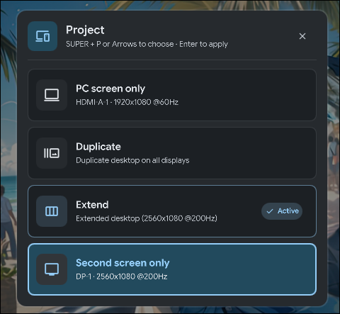

# Display Project (Win+P) for DankMaterialShell (DMS)

[](https://hyprland.org)
[](https://github.com/AvengeMedia/DankMaterialShell)
[](LICENSE)
[](plugin.json)

A native Material Design 3 display projection modal for **Hyprland** on **DankMaterialShell (DMS)**, bringing the familiar Windows **Win + P** multi-monitor switching experience into Linux.

<p align="center">
  
</p>

---

## 🎯 Features

- **Windows Win+P Workflow**:
  - **Press `SUPER + P`**: Opens an elegant centered modal dialog with smooth scale and fade animations.
  - **Press `SUPER + P` again**: Cycles through the 4 projection modes smoothly.
  - **Apply**: Press **Enter**, **Space**, numbers **1-4**, or click any card directly.
  - **No Accidental Changes**: No intrusive auto-apply timer; the selected mode only applies when explicitly confirmed.
  - **Cancel**: Press **Escape** or click anywhere outside to close without applying.
- **4 Standard Modes**:
  1. 💻 **PC Screen Only**: Keeps your primary display active and turns off/sleeps secondary monitors.
  2. 🔁 **Duplicate**: Clones your screen across all displays with matching resolution.
  3. 🖥️ 🖥️ **Extend**: Spans your desktop across all connected monitors with their native resolutions and refresh rates.
  4. 📺 **Second Screen Only**: Puts your primary display to sleep and runs exclusively on your secondary monitor.
- **Dynamic Monitor Detection**: Automatically discovers monitor names, resolutions, refresh rates, and active states.
- **Hardware Mode Locking**: Remembers and restores the true native resolution and refresh rate (e.g. 200Hz / ultrawide) of every connected monitor, preventing downscale lock-in after mirroring.
- **Instant Response**: Built as a persistent QML daemon with sub-millisecond IPC responsiveness.

---

## 🚀 Keybind Setup (Hyprland)

In your `hyprland.lua` (or `hyprland.conf`), bind `SUPER + P` to trigger the IPC endpoint:

### Modern Lua (`~/.config/hypr/hyprland.lua`):
```lua
hl.bind(mainMod .. " + P", hl.dsp.exec_cmd("dms ipc call displayProject cycle"))
```

### Classic Config (`~/.config/hypr/hyprland.conf`):
```ini
bind = $mainMod, P, exec, dms ipc call displayProject cycle
```

---

## 📦 Installation & Setup

1. Clone or copy the repository into your DMS plugins directory:
   ```bash
   git clone https://github.com/WilliamAWSOFTWARE/dms-display-project.git ~/.config/dms/plugins/displayProject
   ```

2. Open **DMS Settings** (`SUPER + N`) → **Plugins** and verify **Display Project (Win+P)** is enabled.

3. Restart DMS:
   ```bash
   dms restart
   ```

---

## 📄 License

This project is licensed under the [MIT License](LICENSE).  
Created with ❤️ for the Linux & Hyprland community by [WilliamAWSOFTWARE](https://github.com/WilliamAWSOFTWARE).
